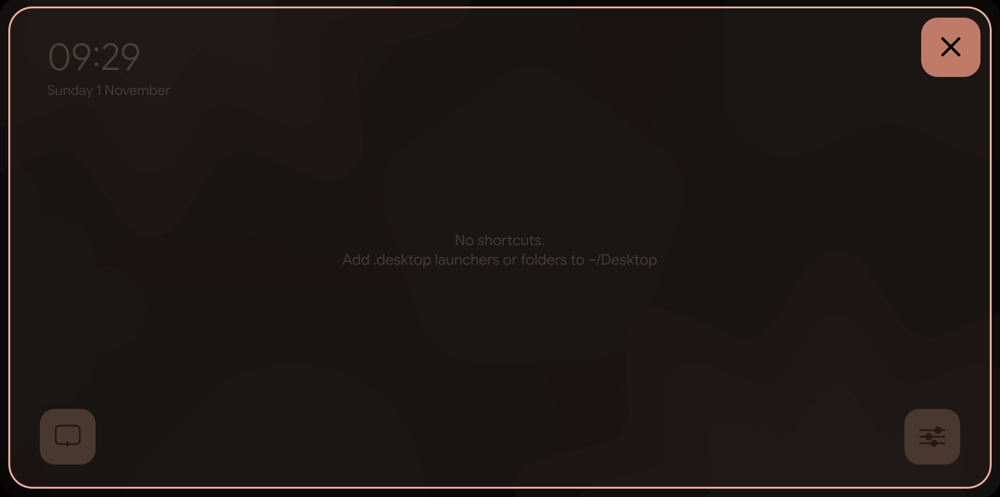
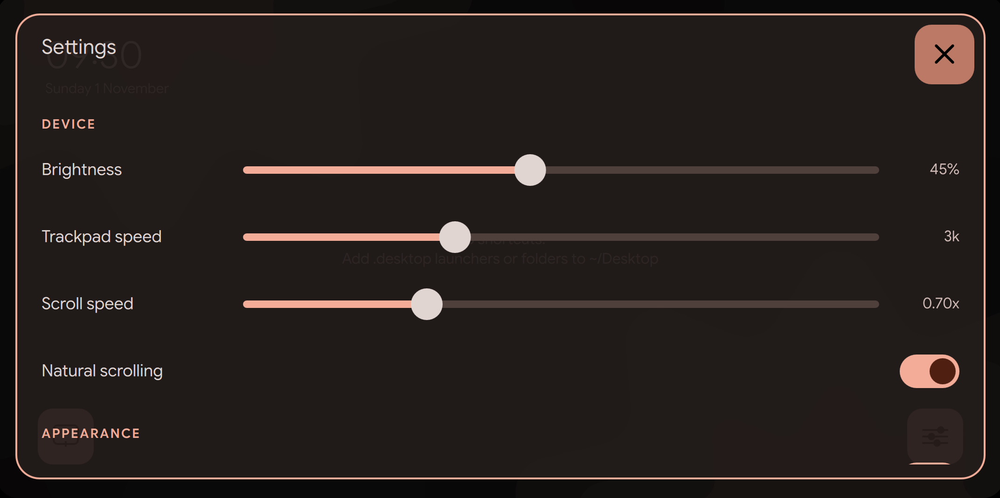

# screenpadctl

ScreenXpert for Linux. On ASUS ZenBooks with a ScreenPad, the secondary touchscreen stays dark and acts as a plain touchpad. screenpadctl gives it three modes: off, touchpad only, or a touch launcher.




C++ and Qt6, no Python. Tested on a ZenBook UX334FA with Arch Linux and Hyprland.

## Install

Requires systemd and Hyprland.

Download the `.deb`, `.rpm` or `.tar.gz` from the Releases page and install it with your package manager, then enable the daemon:

```
sudo systemctl enable --now screenpadctld
```

On Arch, build the package yourself:

```
git clone https://github.com/ungaul/screenpadctl && cd screenpadctl/arch
makepkg -si
sudo systemctl enable --now screenpadctld
```

From source on any distribution: `cmake -B build -DCMAKE_INSTALL_PREFIX=/usr && cmake --build build && sudo cmake --install build`. Needs Qt 6.5+ (base and declarative).

## Usage

```
screenpadctl trackpad | screenpad | off | cycle | status
screenpadctl brightness [1-255]
```

Example keybind for the ScreenPad key:

```lua
hl.bind("XF86TouchpadToggle", hl.dsp.exec_cmd("screenpadctl cycle"), { locked = true })
```

## Theming

Optional, reloaded live, in `~/.config/screenpadctl/`: `colors.json` (flat JSON of Material You roles as `#rrggbb`) and `wallpaper` (an image or a symlink to one). Link them to whatever generates your theme.
